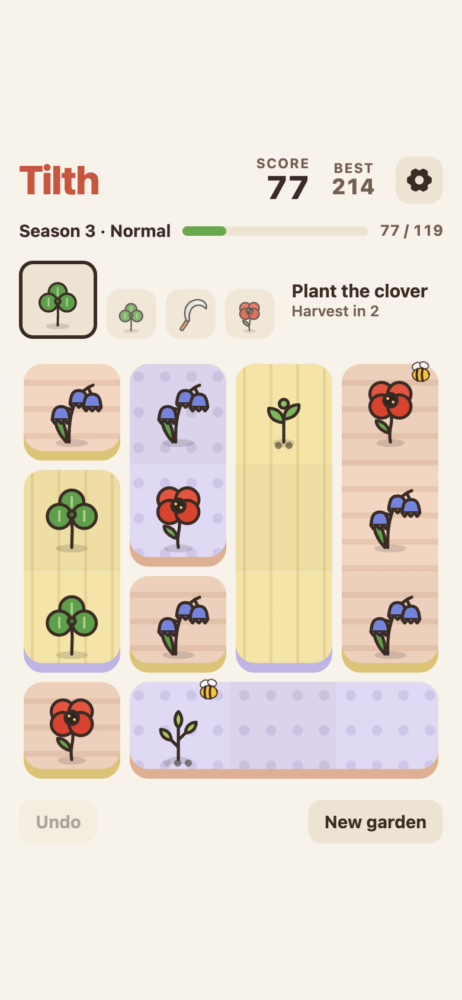
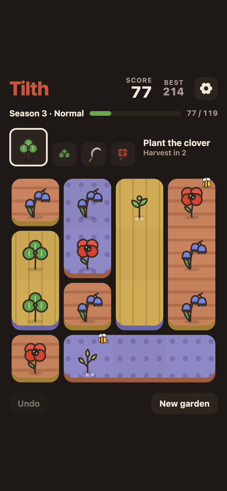
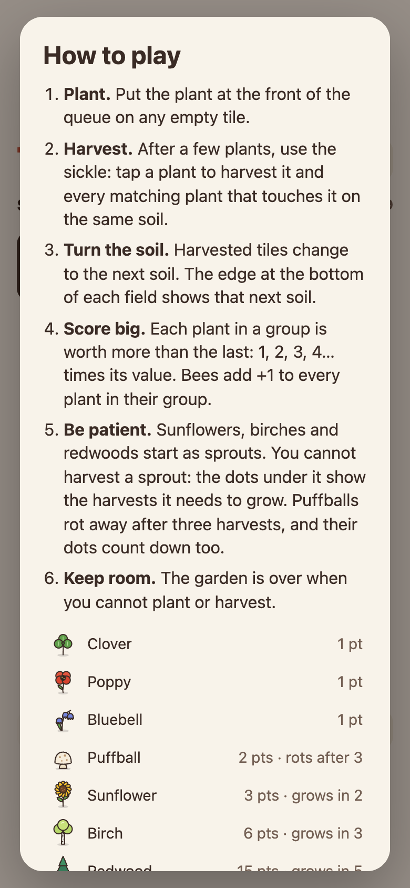

We made a small game. Tilth is a free garden puzzle game that you play in your browser. You can also install it as an app, and then it works offline. It has no ads, no account and no cookies. It is inspired by *Topsoil*, an iOS game from 2017.

**[Play Tilth at tilth.plottwist.hu →](https://tilth.plottwist.hu)**

 

## How to play

- The garden is a 4×4 board. You put plants from a queue on empty tiles.
- Every few turns, you use the sickle. With it, you harvest a group of matching plants that touch each other on the same soil.
- Harvested tiles turn into the next soil, so the board keeps changing.
- Each plant in a group is worth more than the last one: 1, 2, 3, 4… times its value. A bee adds +1 to every plant in its group.

## Seven plants

- **Clover, poppy and bluebell:** 1 point.
- **Puffball:** 2 points, but it rots after 3 harvests.
- **Sunflower:** 3 points. It grows in 2 harvests.
- **Birch:** 6 points. It grows in 3 harvests.
- **Redwood:** 15 points. It grows in 5 harvests.

Slow plants start as sprouts. You cannot harvest a sprout until it grows.

## Also in the garden

- Seasons with rising score goals
- Easy, Normal and Hard modes
- 21 achievements
- One undo
- Light and dark themes
- Synthesized sound effects
- Every move is saved on your device

## Behind the scenes

Tilth is plain ES modules with no build step. The art is SVG, and Web Audio makes the sounds. A service worker lets you play offline, and unit tests run with `node:test`. It is hosted on Cloudflare Pages.

The current version is 1.16.4. See what changed in the [release notes](https://github.com/pltwst/tilth/releases).

## Thank you, Topsoil

Tilth is a fan-made homage to *Topsoil* (2017), an iOS game by Nico Prins. Topsoil is no longer in the App Store. Tilth recreates its rules with original art and sound. Tilth is not affiliated with or endorsed by Nico Prins.

**[Play Tilth →](https://tilth.plottwist.hu)**
