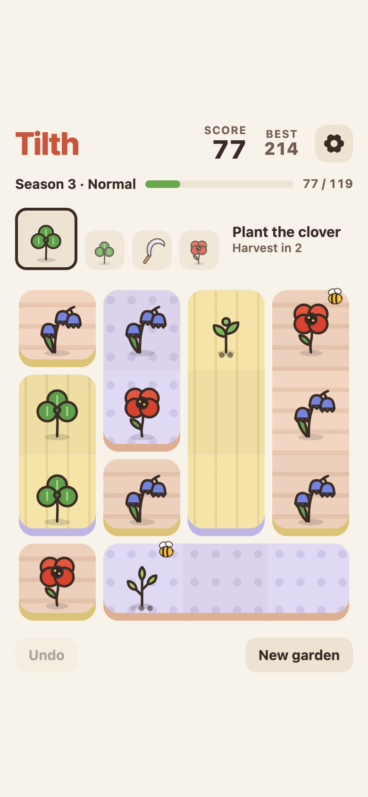
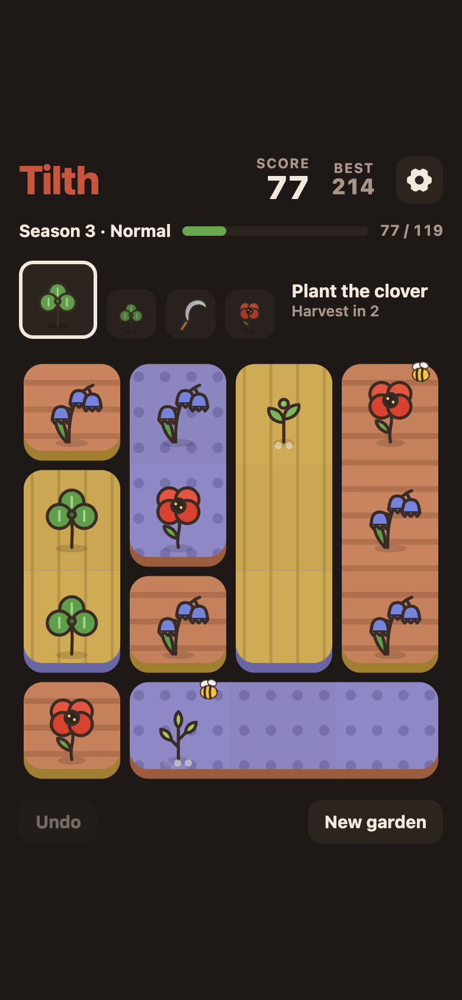
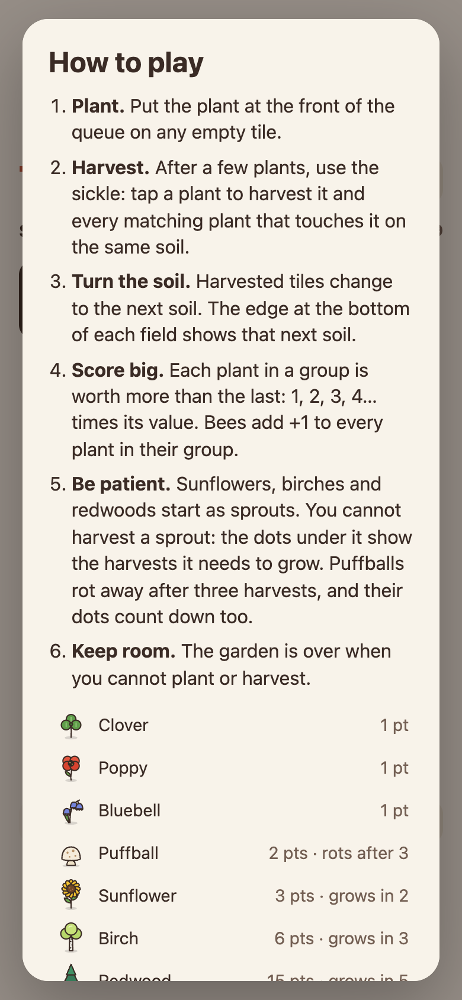

Készítettünk egy kis játékot. A Tilth ingyenes, kertészkedős logikai játék, amelyet a böngésződben játszhatsz. Alkalmazásként is telepítheted, és akkor internet nélkül is működik. Nincs benne reklám, nem kell hozzá fiók, és sütiket sem használ. A *Topsoil* című, 2017-es iOS-játék ihlette. A játék angol nyelvű.

**[Játssz a Tilth-tel: tilth.plottwist.hu →](https://tilth.plottwist.hu)**

 

## Így kell játszani

- A kert egy 4×4-es tábla. A sorban következő növényeket üres mezőkre ülteted.
- Néhány körönként előveszed a sarlót. Ezzel learatsz egy csoportot: egymás mellett álló, egyforma növényeket ugyanazon a talajon.
- A learatott mezők a következő talajra váltanak, így a kert folyamatosan változik.
- A csoportban minden növény többet ér az előzőnél: az értékének 1-, 2-, 3-, 4-szeresét… Egy méh a csoportja minden növényéhez +1 pontot ad.

## Hétféle növény

- **Lóhere, pipacs és harangvirág:** 1 pont.
- **Pöfeteg:** 2 pont, de 3 aratás után elrohad.
- **Napraforgó:** 3 pont. 2 aratás alatt nő meg.
- **Nyírfa:** 6 pont. 3 aratás alatt nő meg.
- **Mamutfenyő:** 15 pont. 5 aratás alatt nő meg.

A lassan növő növények hajtásként indulnak. A hajtást csak akkor aratod le, ha már megnőtt.

## És még

- Évszakok, egyre magasabb pontcélokkal
- Könnyű, normál és nehéz mód
- 21 teljesítmény
- Egy visszavonás
- Világos és sötét téma
- Szintetizált hanghatások
- Minden lépést elment az eszközödön

## A színfalak mögött

A Tilth sima ES-modulokból áll, buildlépés nélkül. A rajzok SVG-k, a hangokat a Web Audio állítja elő. Az offline játékért egy service worker felel, a unit teszteket pedig a `node:test` futtatja. Az oldal a Cloudflare Pagesen fut.

A jelenlegi verzió az 1.16.4. A változásokat a [kiadási jegyzetekben](https://github.com/pltwst/tilth/releases) találod.

A forráskód [a GitHubon](https://github.com/pltwst/tilth) érhető el. Hibajelentéseket és pull requesteket is szívesen fogadunk. Ha segítenél, olvasd el a README [Contributing](https://github.com/pltwst/tilth#contributing) részét.

## Köszönjük, Topsoil

A Tilth rajongói tisztelgés a *Topsoil* (2017) előtt. Ezt az iOS-játékot Nico Prins készítette, és már nem érhető el az App Store-ban. A Tilth saját rajzokkal és hangokkal alkotja újra a szabályait. A Tilth független projekt: nem kapcsolódik Nico Prinshez, és ő nem is hagyta jóvá.

**[Kipróbálom a Tilth-et →](https://tilth.plottwist.hu)**
